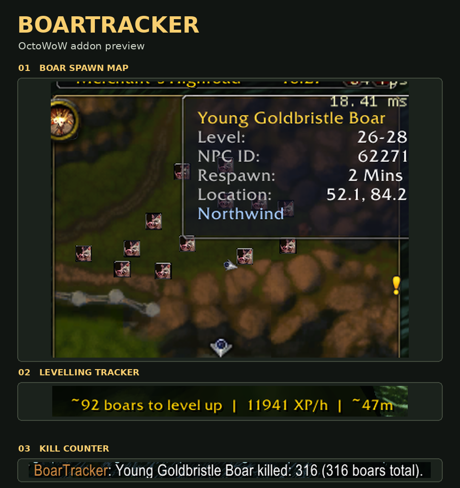

# BoarTracker

Standalone boar spawn tracker for **WoW 1.12.1 / OctoWoW**. No pfQuest required.

- Shows individual boar spawn points on **zone maps only** and on the **minimap**.
- Hover a marker for **name, level, NPC ID, respawn time and coordinates**.
- Includes vanilla and Octo/Turtle boars, including Forest Boars and Elder Forest Boars.

## Preview of v0.3.3

The screenshots show v0.3.3. The addon source on `main` is v0.2.1.

- **Boar spawn map** — Find boars and check their level range, coordinates and respawn time.
- **Kill counter** — See your kills for each type of boar and your total across all boars.
- **Levelling tracker** — See your estimated boars remaining, XP per hour and time to level up. The tracker uses the XP you earn from kills, so it works with half XP and other XP rates.

In v0.3.3, use `/bt tracker on` to show the levelling display or `/bt tracker off` to hide it. Hold **Shift** and drag to move it.

## Install

Place the repo folder at:

`World of Warcraft\Interface\AddOns\BoarTracker`

## Commands

`/bt` — status  
`/bt map` — toggle zone-map pins  
`/bt mini` — toggle minimap pins  
`/bt on` / `/bt off` — enable or disable both

Spawn data is derived from pfQuest/pfQuest-turtle database data under its MIT licence; the addon has no runtime dependency on pfQuest.

### v0.2.1
- Fixed boar icons appearing on Azeroth/continent maps. Map pins now render only on individual zone maps.
